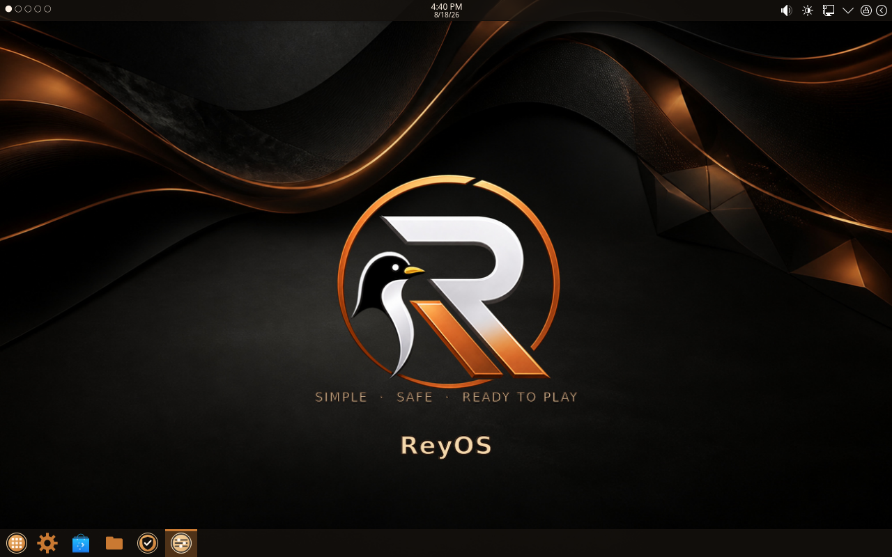
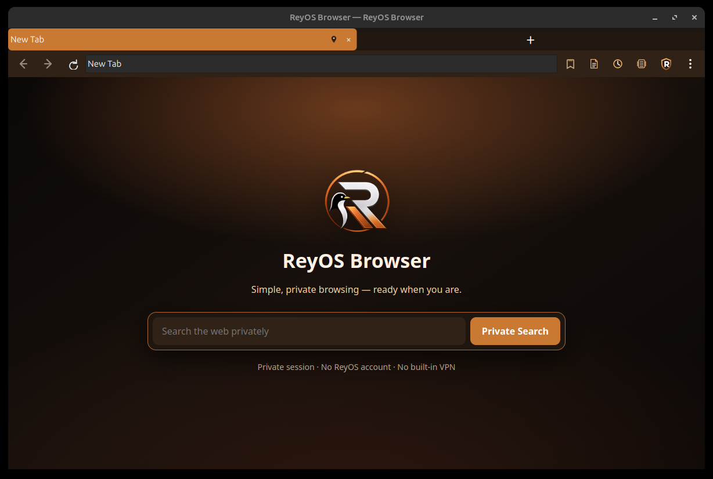

# ReyOS

**SIMPLE · SAFE · READY TO PLAY**

ReyOS is a calm, dependable KDE Plasma Linux distribution built on Arch: easy enough that a new user can install, use, and update it without becoming a Linux administrator, powerful enough that an experienced user is never boxed in.

## Screenshots

| Desktop | Reyva (browser) |
|---|---|
|  |  |

## Features

- **KDE Plasma 6** (X11 session by default, Wayland available), tuned for a clean, low-clutter default desktop.
- **Reyva** (the ReyOS browser) — a native PySide6/Qt WebEngine (Chromium) browser, not a wrapper around another browser. Low Memory Mode tab freezing, Reader Mode, Find in Page, printing, downloads to any folder, ReyOS Shields ad/tracker blocking and Install as App. Also available as a Flatpak for any distro, an Ubuntu `.deb` and for Windows.
- **ReyOS Reader** — a native EPUB, PDF and comic (CBZ/CBR) reader with search and PDF annotations.
- **ReyOS Connect** — your phone and computers in one place: pair over KDE Connect, send files, links and the clipboard, use the phone as a remote, open another computer's desktop (RDP/VNC), share this desktop (KDE Remote Desktop, Wayland session), Tailscale/WireGuard VPN, and Bluetooth device linking.
- **Control Center** — one place for updates (ReyOS packages and Flatpaks together), firewall, drivers, backups, Looks (whole-desktop styles), gaming and system settings. Anything that changes the system asks for your password.
- **Stable updates** — Arch packages come from a tested snapshot (the stable channel), moved forward weekly after an automated check that ReyOS's apps still start on it. Updates are never partial: every install button goes through the same full update.
- **Rollback** — new installs use btrfs with an automatic snapshot before every update; each snapshot gets its own boot menu entry, plus an LTS backup kernel.
- **Gaming** — Steam, GameMode and the MangoHud overlay in one click; emulators from NES to PlayStation 2 and 3DS installed per system, with a game library, per-game resolution and windowing, controller setup and a BIOS checker/importer for your own BIOS dumps. No games or BIOS files are included.
- **ReyOS Welcome** — a first-login setup flow for picking optional software instead of hunting through a package manager.
- **Calamares installer** with ReyOS branding, btrfs by default, and a tested end-to-end install path.
- No telemetry by default.

See [docs/vision-roadmap.md](docs/vision-roadmap.md) for the full product direction and [docs/browser.md](docs/browser.md) for Reyva's current feature set.

## Status

ReyOS is in active development. Core install → boot → login → desktop flow is verified on real hardware and VMs; see [docs/bugs.md](docs/bugs.md) and [docs/fixes.md](docs/fixes.md) for the current known-issues and fix log. The latest ISO is [2026.10.16](https://github.com/Reypaulino/ReyOS/releases/tag/reyos-2026.10.16); after installing, run Control Center → Updates → **Update everything** and restart to get the latest fixes and features. btrfs with automatic snapshots and the X11 default session arrive with the next ISO. See [reyos.reyapps.com](https://reyos.reyapps.com) for downloads and installation guidance.

## Repository layout

```
reyos-packages/   PKGBUILDs for every reyos-* package (source of truth for each component)
reyos-iso/        archiso profile used to build the installable ISO
docs/             developer guide, roadmap, bug/fix logs, per-app notes (browser, reader, connect)
flatpak/          Flatpak packaging for Reyva
tools/            stable-channel snapshot check and promotion scripts
website/          source of reyos.reyapps.com
tests/            unit tests (e.g. ReyOS Connect's Syncthing provider)
```

See [docs/DEVELOPER.md](docs/DEVELOPER.md) for the full build workflow.

## Links

- Website: [reyos.reyapps.com](https://reyos.reyapps.com)
